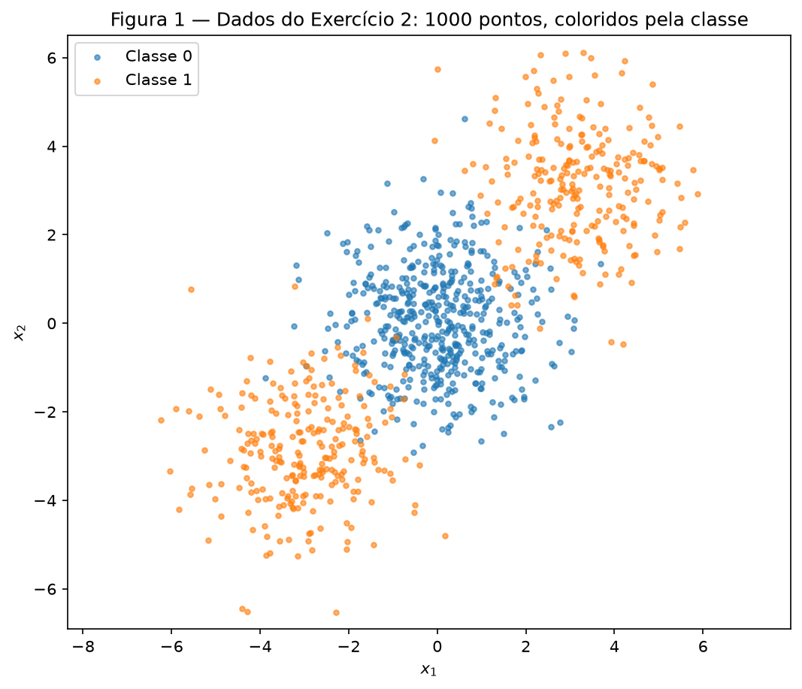
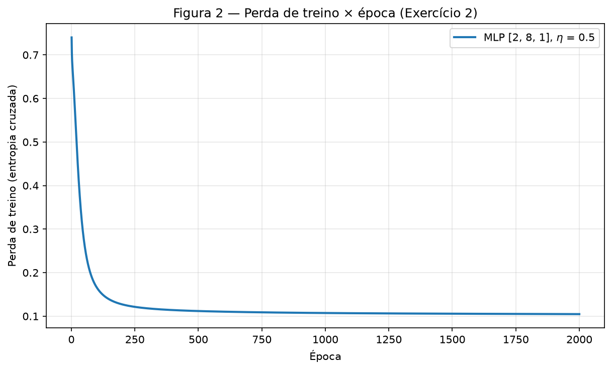
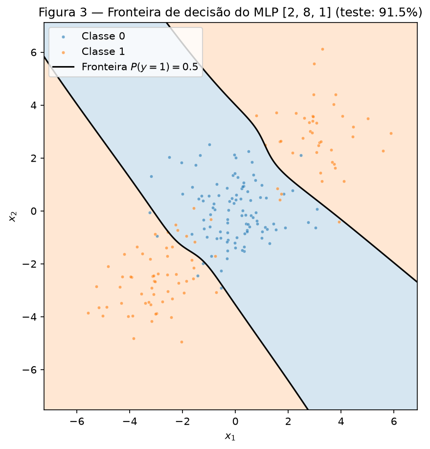
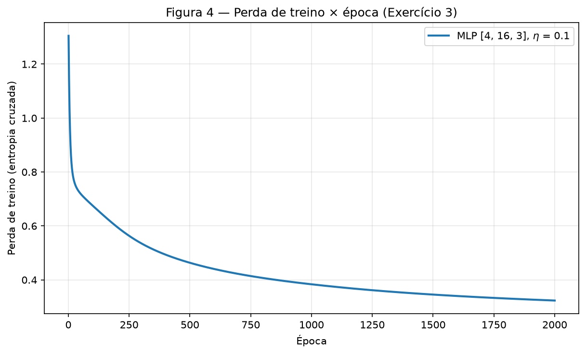
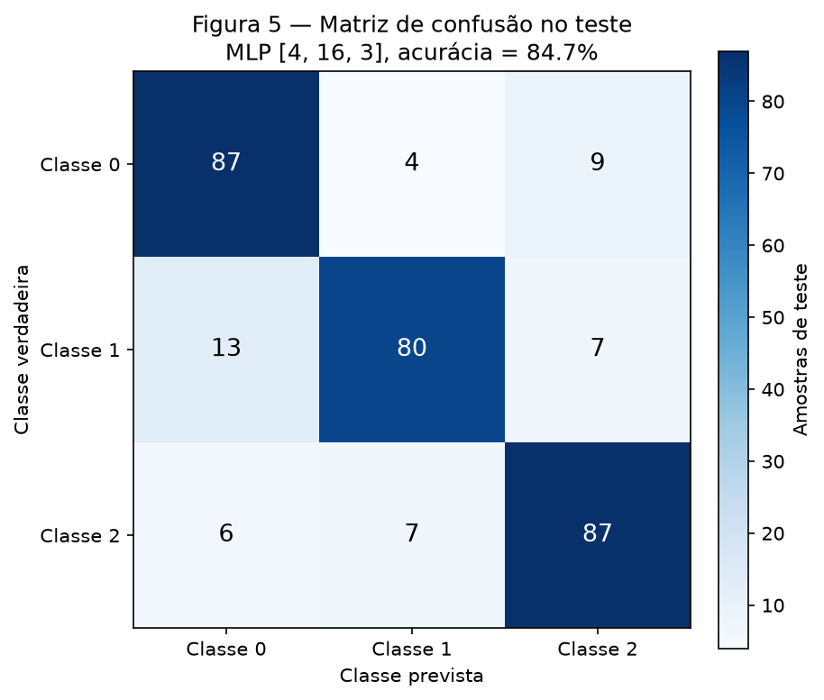
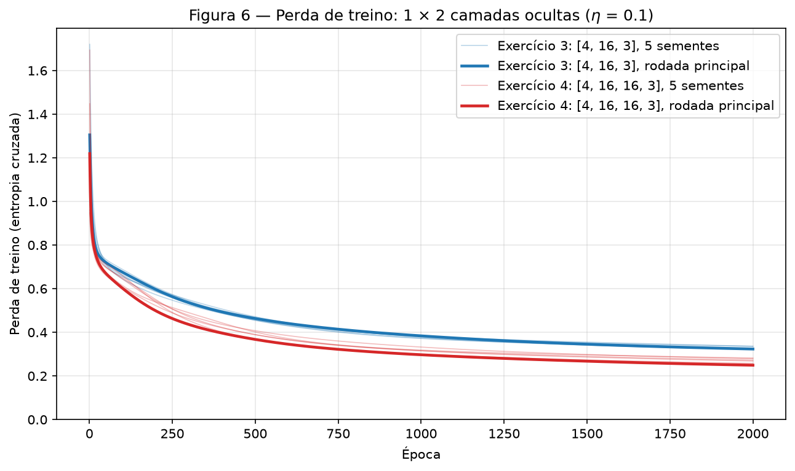

# 3. MLP

!!! abstract "Enunciado"

    [Exercises → MLP](https://insper.github.io/ann-dl/){:target='_blank'}

## Como reproduzir

Todo o código está em `code/`. Um único script roda os Exercícios 2, 3 e 4 em ordem, com **um
único** gerador `rng = np.random.default_rng(42)`. Ele grava as figuras em `figures/` e os números
em `code/results.json`. Todos os números deste relatório vêm desse arquivo. Rodei o script duas
vezes e o `results.json` saiu idêntico byte a byte.

``` shell
python3 -m venv env && source ./env/bin/activate
python3 -m pip install -r requirements.txt
python docs/exercises/mlp/code/run_all.py
python docs/exercises/mlp/code/gradcheck.py   # confere os gradientes (não muda o relatório)
```

??? example "Código — `code/run_all.py` e `code/common.py` (semente, pastas e figuras)"

    ``` { .python linenums="1" title="docs/exercises/mlp/code/run_all.py" }
    --8<-- "docs/exercises/mlp/code/run_all.py"
    ```

    ``` { .python linenums="1" title="docs/exercises/mlp/code/common.py" }
    --8<-- "docs/exercises/mlp/code/common.py"
    ```

## Abordagem e desafios

**Abordagem.** O modelo fica num único arquivo, `code/mlp.py`, escrito só com NumPy. A classe `MLP`
recebe os tamanhos das camadas como argumento (`[2, 8, 1]`, `[4, 16, 3]`, `[4, 16, 16, 3]`, ...). Ela
tem a passagem direta (`forward`), a perda, a passagem reversa com cada gradiente escrito à mão
(`backward`) e a atualização (`update`). Os Exercícios 2, 3 e 4 usam essa classe **sem mudar uma
linha**: só os argumentos mudam. O scikit-learn aparece só para gerar e dividir os dados, para a
linha de base (regressão logística) e para a matriz de confusão.

Os sorteios do `rng` acontecem sempre na mesma ordem: pesos iniciais do Exercício 2, pesos iniciais
do Exercício 3, pesos iniciais da rede principal do Exercício 4 e, por fim, os geradores filhos
(`rng.spawn`) das repetições do Exercício 4. Os dados não usam o `rng`: `make_blobs` e
`make_classification` recebem `random_state=42`, como pede o enunciado.

**Desafios.**

- **Provar que os gradientes estão certos.** Um erro de sinal na passagem reversa ainda pode treinar
  "mais ou menos". Por isso, `code/gradcheck.py` compara cada gradiente de `backward` com a
  diferença finita $\frac{L(\theta + \epsilon) - L(\theta - \epsilon)}{2\epsilon}$. O erro relativo
  ficou em $5 \times 10^{-10}$ (binário), $1.2 \times 10^{-9}$ (softmax) e $1.7 \times 10^{-9}$
  (softmax com 2 camadas ocultas).
- **Uma passagem reversa só, para binário e multiclasse.** Os pares sigmoide + entropia cruzada
  binária e softmax + entropia cruzada categórica têm a mesma derivada na saída:
  $\partial L / \partial u = \hat{p} - y$ (item 3B). Então `backward` não precisa saber qual saída
  está em uso. Isso garante a reutilização literal do item 3B.
- **Explicar a confusão do Exercício 3 pelos grupos.** O `make_classification` não devolve de qual
  grupo veio cada amostra. A função `cluster_structure` recupera essa informação: ela gera os mesmos
  dados com `shuffle=False` e casa as linhas e as colunas embaralhadas com as originais.
- **Escolha dos hiperparâmetros.** Não há conjunto de validação. Testei algumas combinações
  (tamanho da camada oculta, $\eta$, épocas) olhando a acurácia no teste. Todas ficaram numa faixa
  estreita (91–93% no Exercício 2; 83–86% no Exercício 3). Escolhi uma configuração do meio da
  grade, não a melhor. Mesmo assim, as acurácias no teste são um pouco otimistas.

## Exercício 1

Um passo de retropropagação, na mão. Rede 2–2–1, $\tanh$ nas duas camadas, perda
$L = (y - \hat{y})^2$, com $\mathbf{x} = [0.5,\ -0.2]$, $y = 1.0$ e $\eta = 0.3$. Os números
aparecem com 8 casas decimais. Cada conta usa os valores intermediários sem arredondar; por isso, o
8º dígito pode diferir em 1 de uma conta refeita com os números já arredondados.

### A — Passagem direta

**Pré-ativações da camada oculta**, $\mathbf{z}^{(1)} = \mathbf{W}^{(1)} \mathbf{x} + \mathbf{b}^{(1)}$:

$$
\begin{aligned}
z^{(1)}_1 &= 0.3 \cdot 0.5 + (-0.1)(-0.2) + 0.1 = 0.15 + 0.02 + 0.1 = 0.27000000 \\
z^{(1)}_2 &= 0.2 \cdot 0.5 + 0.4 \cdot (-0.2) + (-0.2) = 0.10 - 0.08 - 0.2 = -0.18000000
\end{aligned}
$$

**Ativações da camada oculta**, $\mathbf{h}^{(1)} = \tanh(\mathbf{z}^{(1)})$:

$$
h^{(1)}_1 = \tanh(0.27) = 0.26362484, \qquad h^{(1)}_2 = \tanh(-0.18) = -0.17808087
$$

**Pré-ativação de saída**, $u^{(2)} = \mathbf{W}^{(2)} \mathbf{h}^{(1)} + b^{(2)}$:

$$
u^{(2)} = 0.5 \cdot 0.26362484 + (-0.3)(-0.17808087) + 0.2 = 0.13181242 + 0.05342426 + 0.2 = 0.38523668
$$

**Saída e perda:**

$$
\hat{y} = \tanh(0.38523668) = 0.36724656, \qquad
L = (1 - 0.36724656)^2 = 0.63275344^2 = 0.40037691
$$

### B — Passagem reversa

**Derivada da perda em relação à saída:**

$$
\frac{\partial L}{\partial \hat{y}} = -2\,(y - \hat{y}) = -2 \cdot 0.63275344 = -1.26550687
$$

**Pela $\tanh$ da saída**, com $\frac{d}{du}\tanh(u) = 1 - \tanh^2(u) = 1 - \hat{y}^2$:

$$
1 - \hat{y}^2 = 1 - 0.36724656^2 = 1 - 0.13487004 = 0.86512996
$$

$$
\frac{\partial L}{\partial u^{(2)}} = \frac{\partial L}{\partial \hat{y}} \cdot (1 - \hat{y}^2)
= -1.26550687 \cdot 0.86512996 = -1.09482791
$$

**Camada de saída.** Como $u^{(2)} = \sum_j W^{(2)}_j h^{(1)}_j + b^{(2)}$, temos
$\partial u^{(2)} / \partial W^{(2)}_j = h^{(1)}_j$ e $\partial u^{(2)} / \partial b^{(2)} = 1$:

$$
\begin{aligned}
\frac{\partial L}{\partial W^{(2)}_1} &= -1.09482791 \cdot 0.26362484 = -0.28862383 \\
\frac{\partial L}{\partial W^{(2)}_2} &= -1.09482791 \cdot (-0.17808087) = 0.19496791 \\
\frac{\partial L}{\partial b^{(2)}} &= -1.09482791
\end{aligned}
$$

**Propagação de volta para a camada oculta.** Agora $\partial u^{(2)} / \partial h^{(1)}_j = W^{(2)}_j$:

$$
\begin{aligned}
\frac{\partial L}{\partial h^{(1)}_1} &= -1.09482791 \cdot 0.5 = -0.54741396 \\
\frac{\partial L}{\partial h^{(1)}_2} &= -1.09482791 \cdot (-0.3) = 0.32844837
\end{aligned}
$$

Pela $\tanh$ oculta, $1 - (h^{(1)}_1)^2 = 1 - 0.06949805 = 0.93050195$ e
$1 - (h^{(1)}_2)^2 = 1 - 0.03171280 = 0.96828720$:

$$
\begin{aligned}
\frac{\partial L}{\partial z^{(1)}_1} &= -0.54741396 \cdot 0.93050195 = -0.50936975 \\
\frac{\partial L}{\partial z^{(1)}_2} &= 0.32844837 \cdot 0.96828720 = 0.31803236
\end{aligned}
$$

**Camada oculta.** Como $z^{(1)}_i = \sum_k W^{(1)}_{ik} x_k + b^{(1)}_i$, temos
$\partial L / \partial W^{(1)}_{ik} = \frac{\partial L}{\partial z^{(1)}_i}\, x_k$ (um produto
externo) e $\partial L / \partial b^{(1)}_i = \frac{\partial L}{\partial z^{(1)}_i}$:

$$
\frac{\partial L}{\partial \mathbf{W}^{(1)}} =
\begin{bmatrix} -0.50936975 \cdot 0.5 & -0.50936975 \cdot (-0.2) \\ 0.31803236 \cdot 0.5 & 0.31803236 \cdot (-0.2) \end{bmatrix} =
\begin{bmatrix} -0.25468488 & 0.10187395 \\ 0.15901618 & -0.06360647 \end{bmatrix}
$$

$$
\frac{\partial L}{\partial \mathbf{b}^{(1)}} = [-0.50936975,\ 0.31803236]
$$

### C — Atualização dos parâmetros

Com $\theta \leftarrow \theta - \eta\, \partial L / \partial \theta$ e $\eta = 0.3$:

$$
\begin{aligned}
W^{(2)}_1 &= 0.5 - 0.3 \cdot (-0.28862383) = 0.5 + 0.08658715 = \mathbf{0.58658715} \\
W^{(2)}_2 &= -0.3 - 0.3 \cdot 0.19496791 = -0.3 - 0.05849037 = \mathbf{-0.35849037} \\
b^{(2)} &= 0.2 - 0.3 \cdot (-1.09482791) = 0.2 + 0.32844837 = \mathbf{0.52844837} \\
W^{(1)}_{11} &= 0.3 - 0.3 \cdot (-0.25468488) = 0.3 + 0.07640546 = \mathbf{0.37640546} \\
W^{(1)}_{12} &= -0.1 - 0.3 \cdot 0.10187395 = -0.1 - 0.03056219 = \mathbf{-0.13056219} \\
W^{(1)}_{21} &= 0.2 - 0.3 \cdot 0.15901618 = 0.2 - 0.04770485 = \mathbf{0.15229515} \\
W^{(1)}_{22} &= 0.4 - 0.3 \cdot (-0.06360647) = 0.4 + 0.01908194 = \mathbf{0.41908194} \\
b^{(1)}_1 &= 0.1 - 0.3 \cdot (-0.50936975) = 0.1 + 0.15281093 = \mathbf{0.25281093} \\
b^{(1)}_2 &= -0.2 - 0.3 \cdot 0.31803236 = -0.2 - 0.09540971 = \mathbf{-0.29540971}
\end{aligned}
$$

**A perda desce numa segunda passagem direta.** O motivo: cada parâmetro andou no sentido
contrário ao seu gradiente. Na aproximação de primeira ordem,

$$
L(\theta - \eta \mathbf{g}) \approx L(\theta) - \eta\, \lVert \mathbf{g} \rVert^2 ,
\qquad \lVert \mathbf{g} \rVert^2 = 1.78514 ,
$$

e o termo $-\eta \lVert \mathbf{g} \rVert^2 = -0.53554$ é sempre negativo. A aproximação só vale
para passos pequenos, e aqui o passo não é pequeno: ela preveria uma perda negativa. Por isso fiz a
segunda passagem direta com os parâmetros novos:

$$
\mathbf{z}^{(1)} = [0.46712609,\ -0.30307852], \quad
\mathbf{h}^{(1)} = [0.43587433,\ -0.29412735], \quad
u^{(2)} = 0.88956848, \quad
\hat{y} = 0.71118053
$$

$$
L = (1 - 0.71118053)^2 = 0.08341669
$$

A perda cai de **0.40037691** para **0.08341669**. Todas as mudanças empurram $\hat{y}$ para o
alvo $y = 1$: $b^{(2)}$ sobe; $W^{(2)}_1$ sobe porque $h^{(1)}_1 > 0$; $W^{(2)}_2$ desce porque
$h^{(1)}_2 < 0$. Os dois produtos $W^{(2)}_j h^{(1)}_j$ crescem. A camada oculta também ajuda: ela
aumenta $h^{(1)}_1$ e deixa $h^{(1)}_2$ mais negativo.

## Exercício 2

Classificação binária que uma reta não resolve.

??? example "Código — `code/ex2_binary.py`"

    ``` { .python linenums="1" title="docs/exercises/mlp/code/ex2_binary.py" }
    --8<-- "docs/exercises/mlp/code/ex2_binary.py"
    ```

### A — Gere os dados

`make_blobs` com os parâmetros do enunciado, sem alterações: centros $[0, 0]$, $[3, 3]$ e
$[-3, -3]$, com 500, 250 e 250 pontos, `cluster_std=1.2` e `random_state=42`. O grupo do centro é a
Classe 0; os dois grupos das pontas formam a Classe 1 (`y = (c > 0)`). São 500 pontos por classe. A
divisão é `train_test_split(..., test_size=0.2, random_state=42, stratify=y)`: 800 pontos de treino
e 200 de teste, com 50% de cada classe nos dois conjuntos.


/// caption
**Figura 1** — Os 1000 pontos do Exercício 2, coloridos pela classe. A Classe 1 (laranja) fica nos
dois lados da Classe 0 (azul), ao longo da diagonal $x_1 = x_2$.
///

### B — Estabeleça a linha de base

`LogisticRegression()` ajustada no treino tem acurácia de **47.50%** no teste: pior do que chutar.

### C — Implemente o MLP

``` { .python linenums="1" title="docs/exercises/mlp/code/mlp.py" }
--8<-- "docs/exercises/mlp/code/mlp.py"
```

As quatro partes pedidas, e onde cada uma está no código. Para um lote com $N$ amostras, a camada
$l$ tem pesos $\mathbf{W}^{(l)}$ e bias $\mathbf{b}^{(l)}$; $\mathbf{h}^{(0)} = \mathbf{X}$.

- **Passagem direta** (`forward`): $\mathbf{u}^{(l)} = \mathbf{h}^{(l-1)} \mathbf{W}^{(l)\top} + \mathbf{b}^{(l)}$,
  e $\mathbf{h}^{(l)} = \tanh(\mathbf{u}^{(l)})$ nas camadas ocultas. Na saída,
  $\hat{p} = \sigma(u) = 1 / (1 + e^{-u})$. A função guarda a saída de cada camada, porque a
  passagem reversa precisa delas.
- **Perda** (`binary_cross_entropy`): entropia cruzada binária,
  $L = -\frac{1}{N} \sum_n \left[ y_n \log \hat{p}_n + (1 - y_n) \log (1 - \hat{p}_n) \right]$.
- **Passagem reversa** (`backward`). Na saída, $\partial L / \partial u_n = (\hat{p}_n - y_n) / N$:
  a derivada $\sigma' = \hat{p}(1 - \hat{p})$ cancela o denominador de $\partial L / \partial \hat{p}$.
  Daí, camada por camada, para trás, com $\boldsymbol{\delta}^{(l)} = \partial L / \partial \mathbf{u}^{(l)}$:

    $$
    \frac{\partial L}{\partial \mathbf{W}^{(l)}} = \boldsymbol{\delta}^{(l)\top} \mathbf{h}^{(l-1)}, \qquad
    \frac{\partial L}{\partial \mathbf{b}^{(l)}} = \sum_n \boldsymbol{\delta}^{(l)}_n, \qquad
    \boldsymbol{\delta}^{(l-1)} = \left( \boldsymbol{\delta}^{(l)} \mathbf{W}^{(l)} \right) \odot \left( 1 - (\mathbf{h}^{(l-1)})^2 \right)
    $$

    São as mesmas contas do Exercício 1, agora em forma matricial e somadas sobre o lote.

- **Atualização** (`update`): $\theta \leftarrow \theta - \eta\, \partial L / \partial \theta$ para
  cada peso e bias, uma vez por época, com o lote completo (gradiente descendente em lote).

A **inicialização** é a de Xavier/Glorot: $W_{ij} \sim \mathcal{N}(0,\ 2 / (n_\text{entrada} + n_\text{saída}))$
e biases zerados. Ela mantém a escala das ativações entre camadas e deixa a $\tanh$ fora da
saturação no começo.

**Arquitetura e hiperparâmetros:**

| | Valor |
|---|---|
| Arquitetura | `[2, 8, 1]`: 2 entradas, 1 camada oculta de 8 neurônios $\tanh$, 1 saída sigmoide |
| Parâmetros | 33 |
| Perda | entropia cruzada binária |
| Taxa de aprendizado | $\eta = 0.5$ |
| Épocas | 2000, com o lote completo de 800 pontos (1 atualização por época) |
| Perda de treino | de 0.7401 (época 1) a **0.1047** (época 2000) |
| Acurácia no treino | 96.75% |
| **Acurácia no teste** | **91.50%** (183 de 200) |

Testei também 4 e 16 neurônios, $\eta \in \{0.1, 0.5, 1.0\}$ e 1000 ou 3000 épocas. Todas as
combinações ficaram entre 91% e 93% no teste. O resultado não depende de uma escolha feliz.


/// caption
**Figura 2** — Perda de treino (entropia cruzada binária) a cada época. Ela cai rápido nas primeiras
200 épocas e depois se estabiliza perto de 0.10.
///


/// caption
**Figura 3** — Fronteira de decisão do MLP, avaliada numa grade de 400 × 400 pontos, sobre os 200
pontos de teste. O fundo mostra a classe prevista; a linha preta é $P(y = 1) = 0.5$.
///

### D — Análise

**Por que a reta fica abaixo de 50%.** Os três centros estão na mesma reta, a diagonal
$x_1 = x_2$, e o centro da Classe 0 fica exatamente no meio dos dois centros da Classe 1. Uma
fronteira linear divide o plano em dois semiplanos, e um semiplano é **convexo**: se ele contém
$[3, 3]$ e $[-3, -3]$, contém também o ponto médio $[0, 0]$. Então nenhuma reta põe os dois grupos
laranja de um lado e o grupo azul do outro. O melhor que uma reta faz é cortar fora um grupo laranja
só: ela acerta esse grupo e o azul, e erra o outro grupo laranja inteiro. Isso dá no máximo cerca de
75% (750 de 1000 pontos, menos a sobreposição).

A regressão logística nem chega a essa reta. Os dados são simétricos em relação à origem: trocar
$\mathbf{x}$ por $-\mathbf{x}$ não muda nada. Se uns pesos $\mathbf{w}$ são ótimos, $-\mathbf{w}$
também é. A perda logística é convexa, com um único mínimo, então esse mínimo fica perto de
$\mathbf{w} = \mathbf{0}$. Os pesos ajustados confirmam: $\mathbf{w} = [0.0296,\ 0.0015]$ e
$b = -0.0031$. A probabilidade prevista fica entre 0.457 e 0.544 em todos os 200 pontos de teste:
o modelo é quase um "não sei" em todo lugar. A reta que sobra é quase vertical, perto de
$x_1 = 0.1$, e corta a nuvem azul ao meio. Cada lado fica com metade da Classe 0 e um grupo da
Classe 1, então a acurácia esperada é de 50%. Os 47.50% são esse acaso: 95 acertos em 200, só 5
abaixo de 100.

**O que o MLP faz, segundo a Figura 3.** A região da Classe 0 é uma **faixa diagonal**, de
noroeste a sudeste, entre duas curvas quase paralelas. As curvas cruzam a diagonal mais ou menos no
meio do caminho entre o centro azul e cada centro laranja. A região da Classe 1 são as **duas peças
separadas** fora da faixa: uma a nordeste e outra a sudoeste. Uma reta sozinha não produz essa
região: o lado de uma reta é um semiplano, sempre convexo e conexo. A região da Classe 1 não é nem
uma coisa nem outra: ela tem duas peças, e o segmento entre elas passa pela Classe 0.

A camada oculta resolve isso. Cada neurônio $\tanh$ é uma "reta suave": um semiplano com borda
gradual. Bastam dois deles, um para "acima da curva de cima" e outro para "abaixo da curva de
baixo". A saída soma os dois e a sigmoide faz o limiar: o resultado é a faixa. Com 8 neurônios, as
bordas ainda ganham uma leve curvatura. Os 17 erros de teste ficam na zona de sobreposição entre
as nuvens (desvio-padrão 1.2, centros a $3\sqrt{2} \approx 4.24$ de distância). Nenhuma fronteira
acerta esses pontos.

## Exercício 3

Multiclasse, a mesma rede.

??? example "Código — `code/ex3_multiclass.py`"

    ``` { .python linenums="1" title="docs/exercises/mlp/code/ex3_multiclass.py" }
    --8<-- "docs/exercises/mlp/code/ex3_multiclass.py"
    ```

### A — Gere os dados

`make_classification` com os parâmetros do enunciado, sem alterações: 1500 amostras, 4 features
informativas, 0 redundantes, 0 repetidas, 3 classes, 2 grupos por classe, `class_sep=1.0` e
`random_state=42`. A divisão usa a mesma semente e `stratify=y`: 1200 amostras de treino e 300 de
teste, com 100 de cada classe no teste.

### B — Adapte a rede

As mudanças estão nos argumentos, não no código:

``` python
net = MLP([4, 16, 3], rng, hidden="tanh", output="softmax")
```

- a camada de saída tem **3 unidades** (o último número de `layer_sizes`);
- a **softmax** transforma as 3 saídas em probabilidades:
  $\hat{p}_k = e^{u_k} / \sum_j e^{u_j}$ (função `softmax`; ela subtrai o máximo de cada linha para
  não estourar, o que não muda o resultado);
- a **entropia cruzada categórica** substitui a binária:
  $L = -\sum_k y_k \log \hat{p}_k$, com $\mathbf{y}$ em one-hot (`categorical_cross_entropy` e
  `targets`).

**Derivada de $L$ em relação a $\mathbf{u}$, para uma amostra.** Primeiro, a derivada da softmax.
Para $k = j$, pela regra do quociente,
$\frac{\partial \hat{p}_k}{\partial u_k} = \frac{e^{u_k} \sum_i e^{u_i} - e^{u_k} e^{u_k}}{(\sum_i e^{u_i})^2} = \hat{p}_k (1 - \hat{p}_k)$.
Para $k \neq j$, $\frac{\partial \hat{p}_k}{\partial u_j} = \frac{- e^{u_k} e^{u_j}}{(\sum_i e^{u_i})^2} = -\hat{p}_k \hat{p}_j$.
Os dois casos juntos:

$$
\frac{\partial \hat{p}_k}{\partial u_j} = \hat{p}_k \left( \delta_{kj} - \hat{p}_j \right),
\qquad \delta_{kj} = 1 \text{ se } k = j, \text{ e } 0 \text{ caso contrário.}
$$

Depois, a regra da cadeia através de todas as saídas, porque cada $u_j$ mexe em todas as
$\hat{p}_k$:

$$
\frac{\partial L}{\partial u_j}
= \sum_k \frac{\partial L}{\partial \hat{p}_k} \frac{\partial \hat{p}_k}{\partial u_j}
= \sum_k \left( -\frac{y_k}{\hat{p}_k} \right) \hat{p}_k \left( \delta_{kj} - \hat{p}_j \right)
= -\sum_k y_k \delta_{kj} + \hat{p}_j \sum_k y_k
= -y_j + \hat{p}_j \cdot 1
$$

$$
\boxed{\ \frac{\partial L}{\partial \mathbf{u}} = \hat{\mathbf{p}} - \mathbf{y}\ }
$$

O passo-chave é $\sum_k y_k = 1$ (o alvo é one-hot). Para o lote, a perda é a média, então cada
linha fica dividida por $N$: é a linha `delta = (hs[-1] - Y) / N` de `backward`.

**Por que o resultado é tão simples.** O $\hat{p}_k$ que a softmax põe no numerador cancela o
$1/\hat{p}_k$ que vem da derivada do $\log$. Não é coincidência: a entropia cruzada é o negativo do
log da verossimilhança de uma distribuição categórica, e a softmax é a "função de ligação canônica"
dessa distribuição. O mesmo acontece com sigmoide + entropia cruzada binária (Exercício 2) e com
saída linear + erro quadrático. Nos três casos, o gradiente é **previsão − alvo**. Isso tem duas
consequências:

- o sinal de erro é proporcional ao quanto a rede errou. Ele não some quando a saída satura no
  lado errado. Com softmax + erro quadrático, apareceria um fator $\hat{p}_k(1 - \hat{p}_k)$ que vai a
  zero exatamente quando a rede está muito confiante e errada;
- a passagem reversa não precisa saber qual par está em uso. Por isso `backward` serve aos dois.

**Reutilização literal (ponto extra).** O Exercício 3 chama a mesma classe `MLP` de `code/mlp.py`
que o Exercício 2. As funções `forward`, `backward` e `update` são o mesmo código, intocado. O que
muda são só argumentos: `layer_sizes=[4, 16, 3]`, `output="softmax"` (que escolhe a softmax e a
entropia cruzada categórica), $\eta$ e o número de épocas.

### C — Treine e avalie

| | Valor |
|---|---|
| Arquitetura | `[4, 16, 3]`: 4 entradas, 1 camada oculta de 16 neurônios $\tanh$, 3 saídas softmax |
| Parâmetros | 131 |
| Perda | entropia cruzada categórica |
| Taxa de aprendizado | $\eta = 0.1$ |
| Épocas | 2000, com o lote completo de 1200 amostras |
| Perda de treino | de 1.3050 (época 1) a **0.3234** (época 2000) |
| Acurácia no treino | 87.67% |
| **Acurácia no teste** | **84.67%** (254 de 300) |


/// caption
**Figura 4** — Perda de treino (entropia cruzada categórica) a cada época. Depois da queda rápida
inicial, a perda continua a descer devagar até a época 2000.
///


/// caption
**Figura 5** — Matriz de confusão no conjunto de teste (100 amostras por classe). Linhas: classe
verdadeira; colunas: classe prevista.
///

### D — Análise

**O par mais confundido.** Somando os dois sentidos fora da diagonal da Figura 5:

| Par | Confusões | Detalhe |
|---|---:|---|
| **0 ↔ 1** | **17** | 13 da classe 1 previstos como 0; 4 da classe 0 previstos como 1 |
| 0 ↔ 2 | 15 | 9 da classe 0 previstos como 2; 6 da classe 2 previstos como 0 |
| 1 ↔ 2 | 14 | 7 em cada sentido |

O par mais confundido é **0 ↔ 1**, e a maior célula fora da diagonal é "classe 1 prevista como 0"
(13). A classe 1 também tem o pior acerto: 80 de 100, contra 87 nas outras duas. A diferença entre
os pares é pequena (17, 15 e 14 amostras), então o resultado sólido é a célula 1 → 0, não a ordem
dos três pares.

**A explicação pelos grupos.** O `make_classification` põe cada um dos 6 grupos num **vértice do
hipercubo** $\{-1, +1\}^4$ (com `class_sep=1.0`). Cada grupo nasce de uma normal padrão
multiplicada por uma matriz aleatória $\mathbf{A}$, com entradas uniformes em $[-1, 1]$. Isso dá a
cada grupo uma forma alongada própria, com desvio típico de ~1.15 por eixo. O grupo $k$ recebe o
rótulo $k \bmod 3$. Recuperei o grupo de cada amostra (função `cluster_structure`):

| Grupo | Classe | Vértice (nas colunas de `X`) | Erros no teste | Para onde vão os erros |
|---|---|---|---:|---|
| 0 | 0 | $(-1, -1, -1, -1)$ | 5 de 51 | 2 → classe 1, 3 → classe 2 |
| **1** | **1** | $(-1, +1, -1, -1)$ | **15 de 49** | **10 → classe 0**, 5 → classe 2 |
| 2 | 2 | $(-1, +1, -1, +1)$ | 10 de 46 | 7 → classe 1, 1 → classe 0, 2 com rótulo sorteado de novo |
| 3 | 0 | $(+1, -1, +1, +1)$ | 8 de 49 | 2 → classe 1, 6 → classe 2 |
| 4 | 1 | $(-1, +1, +1, +1)$ | 3 de 49 | 3 → classe 0 |
| 5 | 2 | $(+1, +1, +1, -1)$ | 5 de 56 | 5 → classe 0 |

Dois vértices **vizinhos** diferem em uma só coordenada: a distância entre os centros é 2, menos
de 2 desvios dos grupos. A sobreposição é grande. Os pares de grupos vizinhos são 0–1 (classes 0 e
1), 1–2 (classes 1 e 2) e 2–4 (classes 2 e 1). A estrutura explica o par mais confundido:

- o **grupo 1** (classe 1) é vizinho do **grupo 0** (classe 0). Esse único par de vértices gera 10
  dos 13 erros "classe 1 → 0": é a maior fonte de confusão do teste;
- o grupo 1 é vizinho de **dois** grupos de outras classes (0 e 2). É o grupo mais "cercado", e é o
  que mais erra (15 de 49). Por isso a classe 1 tem o pior acerto;
- as classes 1 e 2 também são vizinhas (grupos 1–2 e 2–4). Elas trocam 14 amostras, quase tanto
  quanto 0 ↔ 1;
- as classes 0 e 2 não têm vértices vizinhos (a menor distância é de 2 coordenadas,
  $2\sqrt{2} \approx 2.83$), mas trocam 15 amostras. Aqui pesa a forma alongada dos grupos: ela
  estica alguns grupos na direção de um vértice que não é vizinho.

Há também ruído de rótulo: o padrão `flip_y=0.01` sorteia de novo o rótulo de ~1% das amostras, e
11 das 1500 terminaram com um rótulo diferente do rótulo do seu grupo. Nenhum modelo acerta esses
pontos de forma confiável.

**Comparação com a linha de base.** A regressão logística multinomial tem **66.33%** no teste; o
MLP tem **84.67%**: **+18.3 pontos**. A camada oculta acrescenta regiões **não convexas**. Um
modelo linear com softmax dá a cada classe uma região convexa: uma interseção de semiespaços. Mas
cada classe aqui são dois grupos em vértices distantes. A classe 0 ocupa os vértices
$(-1, -1, -1, -1)$ e $(+1, -1, +1, +1)$, que diferem em 3 coordenadas. Uma região convexa que
cobre os dois cobre também o que fica entre eles, e lá estão grupos de outras classes. Com a
camada oculta, a rede monta a região de cada classe como a **união** de duas peças, uma por grupo,
como fez com os dois grupos laranja do Exercício 2.

## Exercício 4

Uma segunda camada oculta ajuda?

??? example "Código — `code/ex4_depth.py`"

    ``` { .python linenums="1" title="docs/exercises/mlp/code/ex4_depth.py" }
    --8<-- "docs/exercises/mlp/code/ex4_depth.py"
    ```

### A — Treine a rede mais profunda

A única mudança é a profundidade. Repeti a camada oculta do Exercício 3: `[4, 16, 3]` passa a
`[4, 16, 16, 3]`. Os dados, a divisão, a ativação $\tanh$, a saída softmax, $\eta = 0.1$ e as 2000
épocas são os mesmos. Os pesos iniciais vêm do mesmo `rng` do relatório.

``` python
net = MLP([4, 16, 16, 3], rng, hidden="tanh", output="softmax")
```

| | Valor |
|---|---|
| Arquitetura | `[4, 16, 16, 3]`: 2 camadas ocultas de 16 neurônios $\tanh$ |
| Parâmetros | 403 |
| Perda final de treino | 0.2493 |
| Acurácia no treino | 90.50% |
| **Acurácia no teste** | **86.00%** (258 de 300) |

### B — Compare

Para comparar modelos e não sorte, rodei as duas redes com **5 inicializações diferentes**. Cada
repetição usa um gerador filho do `rng` do relatório (`rng.spawn(5)`). O mesmo gerador filho
inicializa as duas redes daquela repetição. Médias ± desvio-padrão das 5 sementes:

| | Camadas ocultas | Parâmetros | Perda final de treino | Acurácia no treino | Acurácia no teste |
|---|---:|---:|---:|---:|---:|
| Exercício 3 | 1 | 131 | 0.3284 ± 0.0071 | 87.80% | **84.27% ± 0.55** |
| Exercício 4 | 2 | 403 | 0.2718 ± 0.0096 | 90.20% | **86.13% ± 0.80** |

**Diferença no teste (profunda − rasa), por semente:** +1.33, +2.00, +1.33, +3.00 e +1.67 pontos;
média **+1.87 ± 0.69 pontos**. Com este orçamento de treino, a rede mais profunda ganha nas 5
sementes.


/// caption
**Figura 6** — Perda de treino × época das duas redes, nos mesmos eixos. Linhas grossas: a rodada
principal de cada exercício. Linhas finas: as 5 repetições de cada rede. $\eta = 0.1$ e 2000
épocas nas duas.
///

### C — Análise

**O que medi.** Com o orçamento do Exercício 3 ($\eta = 0.1$, 2000 épocas), a rede de 2 camadas
ocultas ganha por pouco: **+1.87 pontos** em média, nas 5 sementes. Isso contraria a expectativa do
enunciado, e reporto como saiu. Mas o ganho é pequeno e frágil. Num teste de 300 amostras, 1 ponto
são 3 amostras: a diferença média são ~6 amostras. O ruído de amostragem de uma acurácia de 85%
nesse teste é $\sqrt{0.85 \cdot 0.15 / 300} \approx 2.1$ pontos. O experimento abaixo mostra que o
sinal da diferença depende do orçamento de treino.

**Por que a rede profunda ganha aqui: otimização, não representação.** Na Figura 6, as duas curvas
ainda descem na época 2000: nenhuma rede convergiu. Com gradiente descendente em lote e
$\eta = 0.1$, 2000 passos são um orçamento curto, e a rasa termina **subtreinada**. A rede profunda
tem 3 vezes mais parâmetros (403 contra 131). Ela desce mais rápido por época: perda 0.27 contra
0.33. A vantagem, então, é chegar antes, dentro de um orçamento fixo. Não é uma fronteira que a
rede rasa não conseguiria representar.

**Experimento extra: mais orçamento para as duas.** Repeti a comparação com $\eta = 0.5$ e 4000
épocas, iguais para as duas redes, com outras 5 sementes. Dentro desse orçamento, só a profundidade
muda. Fiz esse teste depois de ver, numa exploração inicial, que o resultado mudava com o
orçamento.

| $\eta = 0.5$, 4000 épocas | Perda final de treino | Acurácia no treino | Acurácia no teste |
|---|---:|---:|---:|
| `[4, 16, 3]` | 0.2394 | 91.62% | 84.20% ± 1.63 |
| `[4, 16, 16, 3]` | **0.0923** | **97.03%** | 82.80% ± 1.12 |

Agora a profunda **perde**: **−1.40 ± 1.67 pontos**, em 4 das 5 sementes. A rasa, com o dobro de
tempo, fica onde estava no teste (84.2%): ela já tinha aprendido o que generaliza. A profunda leva
a perda de treino a 0.09 e acerta 97% do treino. Ela **memoriza** pontos da zona de sobreposição
entre grupos e os rótulos sorteados de novo, e isso custa acurácia no teste.

**A perda de treino conta a mesma história que o teste? Não.** A rede profunda tem a menor perda de
treino nos dois orçamentos (0.27 contra 0.33; 0.09 contra 0.24). No teste, a ordem se inverte de
um orçamento para o outro. Com classes que se sobrepõem, uma perda de treino menor não quer dizer
uma fronteira melhor. Quer dizer uma rede mais confiante, inclusive sobre pontos que nenhuma
fronteira acerta.

**O que a estrutura dos dados pede.** São só 6 grupos, um por vértice, mais ou menos gaussianos.
A fronteira ótima entre dois grupos gaussianos é uma superfície quadrática suave. Uma camada de 16
neurônios $\tanh$ já monta uma peça de região por grupo e chega a ~88% no treino. O erro que sobra
vem quase todo da sobreposição entre vértices vizinhos e do ruído de rótulo, e esse erro é
irredutível. Uma segunda camada acrescenta composição: ela combina as "retas suaves" da primeira
em atributos mais complexos. Mas não há nada hierárquico para compor aqui. Do lado do custo, ela
triplica os parâmetros, multiplica mais um jacobiano no caminho do gradiente até a primeira camada
(cada $\tanh'$ é no máximo 1), deixa o treino mais sensível a $\eta$ e ao tempo de treino, e
aumenta a chance de sobreajuste. Em resumo: com orçamento curto, a profundidade compra velocidade;
com orçamento longo, compra sobreajuste. Nos dois casos, a diferença fica perto do ruído do teste.

**Que dados fariam a profundidade compensar.** Dados com **estrutura composicional**, em que o
número de regiões cresce muito mais rápido do que o número de neurônios que uma camada só consegue
pagar. Exemplos: a paridade (XOR) de muitos bits; um tabuleiro de xadrez com muitas casas; espirais
entrelaçadas; e, na prática, imagens, áudio e texto, em que bordas viram partes e partes viram
objetos. Nesses casos, uma rede profunda reusa os atributos de uma camada na seguinte. Para redes
com ReLU, o número de regiões lineares que a rede representa pode crescer exponencialmente com a
profundidade (Montúfar et al., 2014); uma rede rasa precisaria de muito mais neurônios para a mesma
quantidade de regiões. Também ajudaria ter muito mais
dados e classes que não se sobrepõem, para a capacidade extra ir para a fronteira, e não para o
ruído.

## Resumo dos resultados

| # | Quantidade | Valor |
|---|------------|-------|
| 1 | Ex. 1 — $\mathbf{z}^{(1)}$ e $\mathbf{h}^{(1)}$ | $\mathbf{z}^{(1)} = [0.27000000,\ -0.18000000]$; $\mathbf{h}^{(1)} = [0.26362484,\ -0.17808087]$ |
| 2 | Ex. 1 — $u^{(2)}$, $\hat{y}$ e $L$ | $u^{(2)} = 0.38523668$; $\hat{y} = 0.36724656$; $L = 0.40037691$ |
| 3 | Ex. 1 — os oito parâmetros atualizados | $\mathbf{W}^{(1)} = \begin{bmatrix} 0.37640546 & -0.13056219 \\ 0.15229515 & 0.41908194 \end{bmatrix}$; $\mathbf{b}^{(1)} = [0.25281093,\ -0.29540971]$; $\mathbf{W}^{(2)} = [0.58658715,\ -0.35849037]$; $b^{(2)} = 0.52844837$. A perda desce para 0.08341669. |
| 4 | Ex. 2 — acurácia da linha de base linear | 47.50% |
| 5 | Ex. 2 — arquitetura e acurácia no teste | `[2, 8, 1]` ($\tanh$, sigmoide), $\eta = 0.5$, 2000 épocas: **91.50%** |
| 6 | Ex. 3 — arquitetura e acurácia no teste | `[4, 16, 3]` ($\tanh$, softmax), $\eta = 0.1$, 2000 épocas: **84.67%** (linha de base: 66.33%) |
| 7 | Ex. 3 — par de classes mais confundido | 0 ↔ 1 (17 confusões; 13 da classe 1 previstos como 0) |
| 8 | Ex. 4 — arquitetura e acurácia no teste | `[4, 16, 16, 3]`, mesmo $\eta$ e épocas: **86.00%** |
| 9 | Ex. 4 — diferença de acurácia em relação ao Ex. 3 (média de ≥ 3 sementes) | **+1.87 ± 0.69 pontos** (5 sementes: 86.13% contra 84.27%). Com $\eta = 0.5$ e 4000 épocas, a diferença inverte: −1.40 ± 1.67 pontos. |
