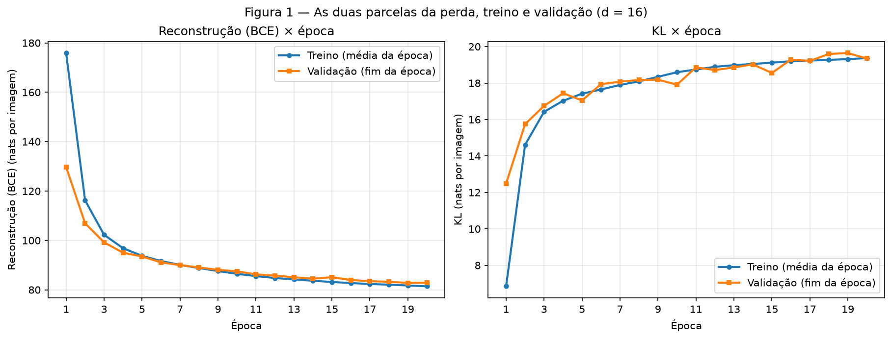
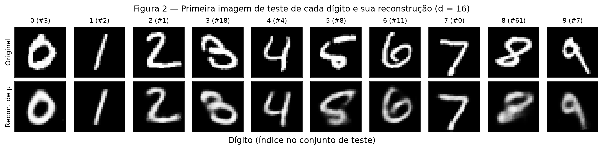
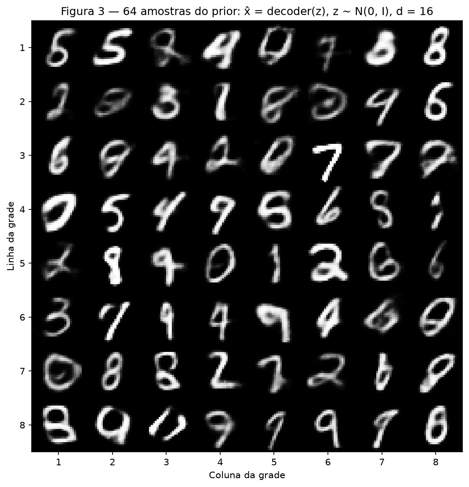
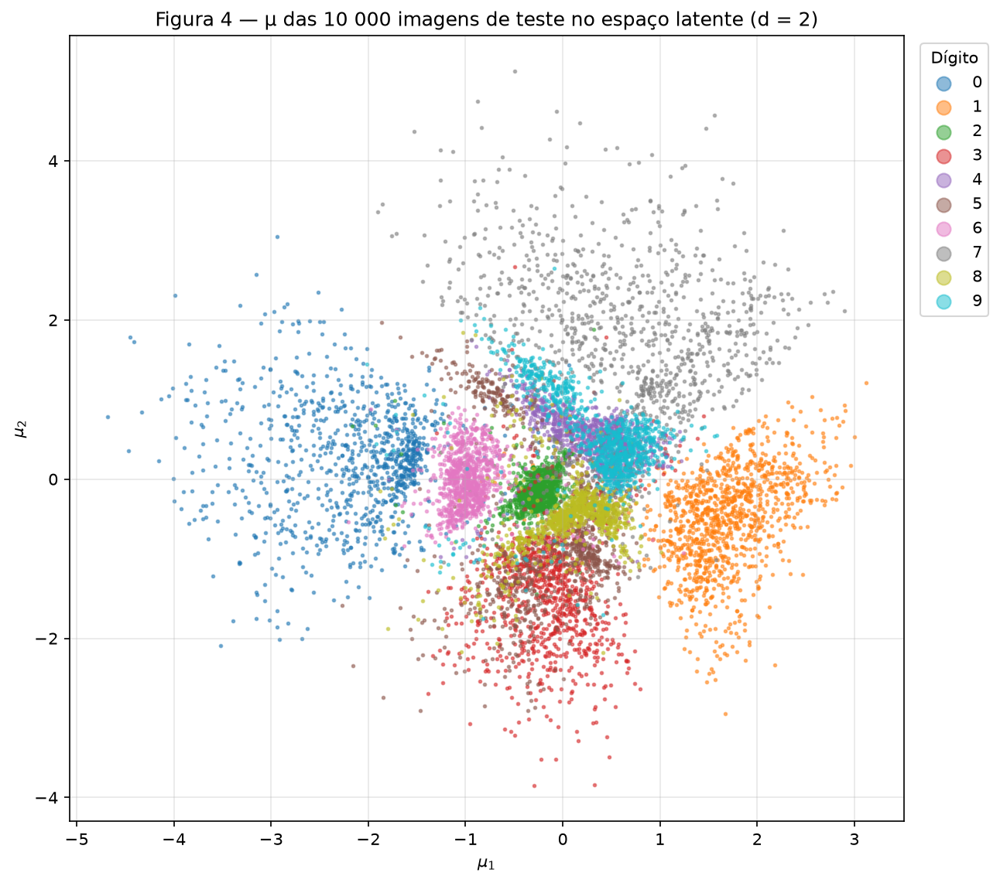
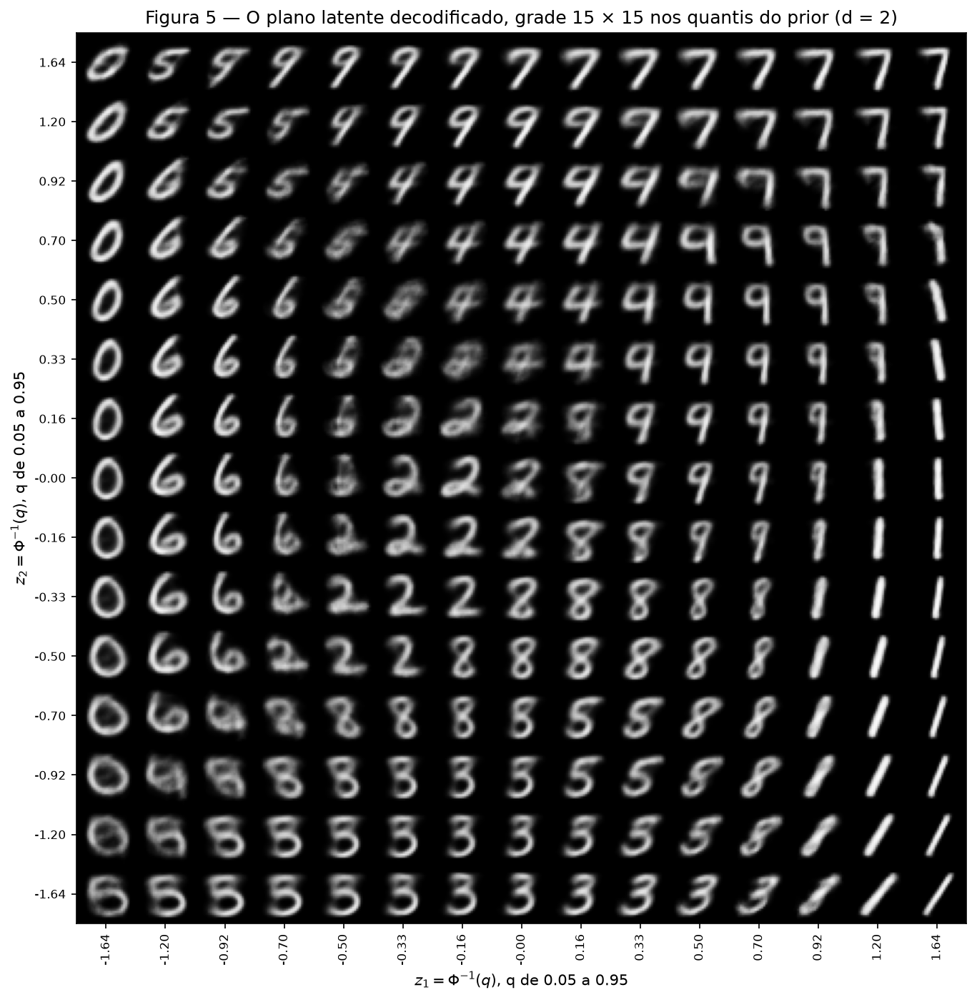
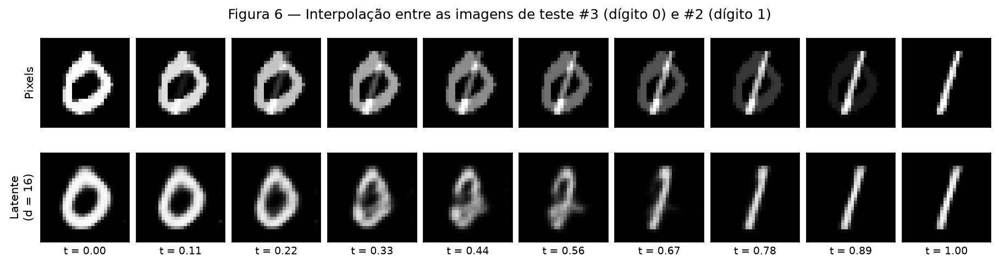

# 4. VAE

!!! abstract "Enunciado"

    [Exercises → VAE](https://insper.github.io/ann-dl/){:target='_blank'}

## Como reproduzir

Todo o código está em `code/`. Um único script roda os Exercícios 1 e 2 em ordem. Ele baixa o
MNIST em `data/` (na raiz do repositório, fora do Git), grava as figuras em `figures/` e os números
em `code/results.json`. Todos os números deste relatório vêm desse arquivo. As sementes são as do
enunciado: `torch.manual_seed(42)` antes de construir cada modelo, o gerador da divisão com semente
42 e `torch.manual_seed(0)` antes da Figura 3. O script liga `torch.use_deterministic_algorithms`.
Rodei o script duas vezes e os números saíram iguais. Na CPU de um Mac M-series, cada modelo leva
cerca de 2 minutos.

``` shell
python3 -m venv env && source ./env/bin/activate
python3 -m pip install -r requirements.txt torch torchvision scipy
python docs/exercises/vae/code/run_all.py
```

??? example "Código — `code/run_all.py` e `code/common.py` (semente, dados e figuras)"

    ``` { .python linenums="1" title="docs/exercises/vae/code/run_all.py" }
    --8<-- "docs/exercises/vae/code/run_all.py"
    ```

    ``` { .python linenums="1" title="docs/exercises/vae/code/common.py" }
    --8<-- "docs/exercises/vae/code/common.py"
    ```

## Abordagem e desafios

**Abordagem.** O modelo, a perda e o laço de treino ficam num único arquivo, `code/vae.py`. O
autograd do PyTorch calcula os gradientes, como o enunciado permite. As partes próprias do VAE
estão escritas à mão: a reparametrização, a BCE somada nos pixels, a KL em forma fechada e a
amostragem do prior. Não uso nenhuma classe de VAE de biblioteca nem `torch.distributions`. O
Exercício 2 chama a mesma função `train` com `d = 2`: só esse argumento muda.

**Desafios.**

- **Manter as duas parcelas em nats por imagem.** `F.binary_cross_entropy(..., reduction="sum")`
  soma nos 784 pixels e no lote; depois divido pelo tamanho do lote. A KL também soma nas $d$
  dimensões e divide pelo lote. Com `reduction="mean"`, a BCE ficaria 784 vezes menor e seria o
  mesmo que usar $\beta \approx 784$.
- **Não deixar a avaliação mexer no treino.** A perda de validação também sorteia $z$. Se o sorteio
  usasse o gerador global, cada avaliação mudaria a ordem dos lotes da época seguinte. Por isso,
  `evaluate` usa um gerador próprio, com semente fixa: o número de validação é sempre o mesmo e o
  treino não muda.
- **O teste só no fim.** `train` recebe só o treino e a validação. O teste entra depois que os dois
  modelos terminam, para os números finais e as Figuras 2 a 6. Nenhuma decisão olha o teste.
- **Medir, e não só olhar.** As perguntas de análise pedem números. Por isso, o script mede também
  a KL de cada dimensão latente, a distância entre as amostras do prior e os códigos dos dados, a
  fração de pixels cinzentos e a sobreposição das classes no espaço latente.

## Exercício 1

Um VAE no MNIST, com $d = 16$.

??? example "Código — `code/ex1_mnist.py`"

    ``` { .python linenums="1" title="docs/exercises/vae/code/ex1_mnist.py" }
    --8<-- "docs/exercises/vae/code/ex1_mnist.py"
    ```

### A — Load and split the data

`load_mnist` em `code/common.py` usa o código do enunciado sem mudança: `datasets.MNIST` com
`transforms.ToTensor()` (pixels em $[0, 1]$) e `random_split(train_full, [50_000, 10_000],
generator=torch.Generator().manual_seed(42))`. Depois, achata cada imagem num vetor de 784. São
50 000 imagens de treino, 10 000 de validação e as 10 000 imagens oficiais de teste. O teste só
aparece depois do treino.

### B — Build the model

``` { .python linenums="1" title="docs/exercises/vae/code/vae.py" }
--8<-- "docs/exercises/vae/code/vae.py"
```

| Parte | Camadas |
|---|---|
| Encoder | $784 \to 512 \to 256$, ReLU depois de cada uma |
| Cabeças | duas lineares $256 \to d$: uma para $\boldsymbol{\mu}$, outra para $\log \boldsymbol{\sigma}^2$ |
| Decoder | $d \to 256 \to 512 \to 784$, ReLU nas ocultas, sigmoide na saída |

**Reparametrização** (`reparameterize`). Sortear $\mathbf{z} \sim \mathcal{N}(\boldsymbol{\mu},
\operatorname{diag} \boldsymbol{\sigma}^2)$ diretamente não deixa o gradiente passar pelo sorteio.
Então o sorteio vai para um ruído que não depende dos parâmetros:

$$
\mathbf{z} = \boldsymbol{\mu} + \boldsymbol{\sigma} \odot \boldsymbol{\varepsilon}, \qquad
\boldsymbol{\varepsilon} \sim \mathcal{N}(\mathbf{0}, \mathbf{I}), \qquad
\boldsymbol{\sigma} = \exp\left(\tfrac{1}{2} \log \boldsymbol{\sigma}^2\right)
$$

Agora $\mathbf{z}$ é uma função diferenciável de $\boldsymbol{\mu}$ e de $\boldsymbol{\sigma}$, e o
gradiente chega ao encoder.

**Perda** (`loss_terms`), por imagem, com $\beta = 1$ e média no lote:

$$
L = \underbrace{-\sum_{j=1}^{784} \left[ x_j \log \hat{x}_j + (1 - x_j) \log (1 - \hat{x}_j) \right]}_{\text{reconstrução (BCE)}}
+ \beta \cdot \underbrace{\frac{1}{2} \sum_{i=1}^{d} \left( \mu_i^2 + \sigma_i^2 - 1 - \log \sigma_i^2 \right)}_{\text{KL}\left(q(\mathbf{z} \mid \mathbf{x}) \,\|\, \mathcal{N}(\mathbf{0}, \mathbf{I})\right)}
$$

A KL está escrita em forma fechada: `0.5 * torch.sum(mu.pow(2) + logvar.exp() - 1.0 - logvar) / n`.
A BCE é $-\log p(\mathbf{x} \mid \mathbf{z})$ sob uma Bernoulli por pixel. A saída sigmoide é a
probabilidade de cada pixel estar aceso.

### C — Train

`train` usa Adam com $\eta = 10^{-3}$, lotes de 128 e 20 épocas. A cada época, grava as duas
parcelas separadas: no treino, a média da época, ponderada pelo tamanho de cada lote; na
validação, o valor no fim da época.

| Conjunto | Reconstrução | KL | $-$ELBO |
|---|---|---|---|
| Validação, época 1 | 129.70 | 12.48 | 142.18 |
| Validação, época 20 | 82.86 | 19.35 | 102.21 |
| **Teste** | **82.16** | **19.37** | **101.53** |

Todos os valores estão em nats por imagem. O teste fica perto da referência do enunciado (cerca
de 81 de reconstrução e 20 de KL).


/// caption
**Figura 1** — As duas parcelas da perda a cada época, com $d = 16$. À esquerda, a reconstrução
cai de 175.88 para 81.41 nats no treino e de 129.70 para 82.86 na validação. À direita, a KL sobe
de 6.85 para 19.37 nats no treino e de 12.48 para 19.35 na validação. Na época 1, as curvas de
treino ficam longe das de validação porque o treino é a média de uma época que começa no modelo
inicial, e a validação é medida no fim dela.
///

### D — Reconstructions and samples


/// caption
**Figura 2** — Em cima, a primeira imagem de teste de cada dígito (índices 3, 2, 1, 18, 4, 8, 11, 0,
61 e 7). Embaixo, a reconstrução decodificando $\boldsymbol{\mu}$, sem sortear $\mathbf{z}$.
///


/// caption
**Figura 3** — 64 imagens decodificadas de $\mathbf{z} \sim \mathcal{N}(\mathbf{0}, \mathbf{I})$,
sorteadas depois de `torch.manual_seed(0)`.
///

### E — Analysis

**Por que a KL sobe enquanto a perda total cai (Figura 1).** A KL mede quanta informação sobre
$\mathbf{x}$ o código $\mathbf{z}$ leva. Com KL zero, $q(\mathbf{z} \mid \mathbf{x})$ é igual ao
prior para toda imagem. Então $\mathbf{z}$ não diz nada sobre $\mathbf{x}$, e o decoder só pode
devolver o "dígito médio". Essa é uma reconstrução muito cara. Cada nat de KL que o encoder gasta
compra um código mais específico, e o decoder reconstrói melhor. No começo do treino, a troca é
muito vantajosa: da época 1 para a 2, a KL de validação sobe 3.26 nats e a reconstrução cai 22.77
nats. O otimizador minimiza a soma, não cada parcela. Por isso ele aceita pagar mais KL sempre que
a reconstrução cai mais do que isso. Ao longo das 20 épocas, a KL de validação vai de 12.48 para
19.35 nats (+6.87), e a reconstrução cai de 129.70 para 82.86 (−46.84). A troca para quando um nat
a mais de código já não compra um nat a mais de reconstrução: depois da época 10, a KL quase não se
move.

O mesmo cálculo aparece em cada dimensão. Das 16 dimensões, só 11 têm KL acima de 0.1 nat no teste
(de 0.85 a 2.55 nats cada). As outras 5 têm KL de 0.001 nat ou menos: nelas o encoder devolve o
próprio prior, e o decoder ignora a coordenada. O otimizador só paga KL onde ela compra
reconstrução.

**Por que a Figura 3 é pior do que a Figura 2.** São dois motivos diferentes.

1. **Onde as amostras do prior caem.** O encoder não preenche o prior por igual. Os códigos das
   imagens reais formam grupos, com regiões quase vazias entre eles. Em média, a dispersão total
   dos códigos é a do prior (variância agregada de 1.000 por dimensão), mas a forma não é. Por
   isso, uma parte dos $\mathbf{z}$ sorteados do prior cai nesses buracos. Medi isso nas 11
   dimensões ativas (nas outras 5, o decoder ignora a coordenada). A distância mediana de uma
   amostra do prior até o $\boldsymbol{\mu}$ de teste mais próximo é 1.68, contra 1.29 para o
   $\boldsymbol{\mu}$ de uma imagem de validação. Uma imagem real de validação fica a mais de
   uma certa distância dos códigos de teste em só 5% dos casos; uma amostra do prior, em **32.9%**
   dos casos. Então cerca de um terço das amostras cai numa região onde quase não há dados: o
   decoder quase nunca recebeu um $\mathbf{z}$ desses no treino. Então ele devolve uma mistura de formas, que às vezes
   não é dígito nenhum (na Figura 3: linha 1, coluna 3; linha 2, coluna 2; linha 5, coluna 1;
   linha 8, coluna 3).
2. **O que o decoder devolve para um $\mathbf{z}$.** A saída $\hat{\mathbf{x}}$ não é uma imagem
   sorteada. É a média de $p(\mathbf{x} \mid \mathbf{z})$: a probabilidade de cada pixel estar
   aceso. A BCE é mínima quando $\hat{x}_j$ é a média dos pixels de todas as imagens compatíveis com
   aquele $\mathbf{z}$. Quando várias formas são compatíveis (traço mais à esquerda ou mais à
   direita, mais grosso ou mais fino), a média é um borrão cinza. Medi a fração de pixels com valor
   entre 0.1 e 0.9: 8.6% nas imagens de teste, 15.0% nas reconstruções de $\boldsymbol{\mu}$ e
   16.8% nas amostras do prior. As reconstruções já são borradas pelo mesmo motivo. As amostras são
   ainda mais, porque um $\mathbf{z}$ longe dos dados é compatível com mais formas.

**Por que decodificar $\boldsymbol{\mu}$ na Figura 2.** $\boldsymbol{\mu}$ é o código mais provável
de $q(\mathbf{z} \mid \mathbf{x})$: o centro da região que o encoder reserva para aquela imagem. Um
$\mathbf{z}$ sorteado soma ao centro um ruído $\boldsymbol{\sigma} \odot \boldsymbol{\varepsilon}$.
Esse ruído leva o código para os vizinhos, e a figura mostraria uma variação aleatória da imagem,
diferente a cada execução. A figura quer mostrar o que o modelo guardou da imagem, não o ruído do
sorteio. No teste, decodificar $\boldsymbol{\mu}$ dá 77.17 nats de reconstrução, contra 82.16 com
$\mathbf{z}$ sorteado.

## Exercício 2

Um espaço latente que dá para ver, com $d = 2$.

??? example "Código — `code/ex2_latent2d.py`"

    ``` { .python linenums="1" title="docs/exercises/vae/code/ex2_latent2d.py" }
    --8<-- "docs/exercises/vae/code/ex2_latent2d.py"
    ```

### A — Train a 2-D VAE

Mesmo modelo, mesmos dados, mesma semente, $\beta = 1$ e o mesmo orçamento (Adam, $10^{-3}$, lotes
de 128, 20 épocas). Só $d$ muda: `train(2, x_train, x_val)`.

| Modelo (teste) | Reconstrução | KL | $-$ELBO |
|---|---|---|---|
| $d = 16$ (Exercício 1) | 82.16 | 19.37 | 101.53 |
| $d = 2$ | **136.09** | **6.63** | **142.72** |
| Diferença | +53.93 | −12.74 | +41.19 |

Os números de $d = 2$ ficam perto da referência do enunciado (cerca de 135 e 7 nats).

### B — The encoded test set


/// caption
**Figura 4** — $\boldsymbol{\mu}$ das 10 000 imagens de teste no espaço latente de $d = 2$, com
uma cor por dígito.
///

### C — The decoded plane

Cada eixo usa $z = \Phi^{-1}(q)$, com $q$ em 15 valores igualmente espaçados em $[0.05, 0.95]$
(`scipy.stats.norm.ppf`). A coluna é $z_1$, crescendo para a direita; a linha é $z_2$, crescendo
para cima, na mesma orientação da Figura 4.

**Por que esse espaçamento.** Como $\Phi$ é a função de distribuição acumulada de
$\mathcal{N}(0, 1)$, pontos igualmente espaçados em $q$ dividem cada eixo em faixas de mesma
probabilidade sob o prior; e como as duas coordenadas são independentes no prior, cada célula da
grade tem a mesma massa de probabilidade. Por isso, a grade fica densa perto da origem, onde o
prior tem mais massa, e esparsa nas bordas.


/// caption
**Figura 5** — As imagens decodificadas de uma grade $15 \times 15$ em $z = \Phi^{-1}(q)$, com
$q \in [0.05, 0.95]$, montadas na mesma disposição dos pontos.
///

### D — Interpolation

Escolhi a primeira imagem de teste de um 0 (**índice 3**) e a primeira de um 1 (**índice 2**). Os
dois dígitos quase não têm pixels em comum. Isso deixa clara a diferença entre as duas
interpolações.


/// caption
**Figura 6** — Interpolação entre as imagens de teste 3 (dígito 0) e 2 (dígito 1), com 10 valores
de $t$ de 0 a 1. Em cima, nos pixels: $(1 - t)\,\mathbf{x}_a + t\,\mathbf{x}_b$. Embaixo, no
espaço latente do modelo $d = 16$ do Exercício 1: decoder de $(1 - t)\,\boldsymbol{\mu}_a +
t\,\boldsymbol{\mu}_b$.
///

### E — Analysis

**Quais dígitos se sobrepõem (Figura 4) e a mesma transição na Figura 5.** Para medir a
sobreposição, classifiquei cada $\boldsymbol{\mu}$ de teste pelo voto dos 15 $\boldsymbol{\mu}$ de
validação mais próximos. Em $d = 2$, esse classificador acerta 79.47%; em $d = 16$, 94.84%. Os
pares mais confundidos em $d = 2$ são **4 ↔ 9** (566 confusões), **3 ↔ 5** (358), 3 ↔ 8 (174),
5 ↔ 8 (161) e 7 ↔ 9 (132). Na Figura 4, as nuvens roxa (4) e ciano (9) quase coincidem, à direita
do centro: as medianas são $(0.33,\ 0.54)$ para o 4 e $(0.48,\ 0.47)$ para o 9. Logo abaixo do
centro, o 8, o 5 e o 3 formam uma faixa vertical contínua: medianas em $(0.12,\ -0.46)$,
$(-0.20,\ -0.90)$ e $(-0.13,\ -1.35)$.

Na Figura 5, a transição 4 ↔ 9 está nas linhas $z_2$ de 0.50 a 0.92. Em cada uma, indo para a
direita, um 4 de topo aberto vira um 9 de laço fechado. A fronteira é inclinada: na linha
$z_2 = 0.70$, a troca acontece em $z_1 \approx 0.33$; na linha $z_2 = 0.92$, já em
$z_1 \approx -0.16$. Nas células da fronteira, as imagens são um 4 cujos dois braços de cima se
encostam e começam a fechar o laço: o mesmo traço serve de 4 e de 9. A transição 3 ↔ 5 aparece na
última linha ($z_2 = -1.64$): o 5, com a barra reta em cima, ocupa as colunas de $-1.64$ a $-0.50$;
o 3, com a curva em cima, começa em $z_1 = -0.33$. A célula da fronteira tem a barriga de baixo,
comum aos dois dígitos, e um topo que é meio barra, meio curva. Um passo para cima
($z_2 = -0.70$ e $-0.92$), aparecem 8 entre eles: é a faixa contínua 3–5–8 da Figura 4.

**O que $d = 2$ joga fora.** Dois números por imagem mal bastam para dizer qual é o dígito. Não
sobra espaço para o estilo: a espessura do traço, a inclinação, o tamanho, os detalhes de cada
escrita. A KL de $d = 2$ é só 6.63 nats por imagem, contra 19.37 em $d = 16$: o código leva menos de
um terço da informação. O preço é 53.93 nats a mais de reconstrução. A Figura 5 mostra isso. Cada
região do plano tem um único dígito "protótipo", liso e de espessura média. Dentro de uma região,
o estilo muda pouco e devagar, sempre na mesma direção: os 1 da direita só giram, de inclinados
(embaixo) para retos (em cima); os 7 do canto de cima são quase iguais entre si; os 0 da esquerda
só mudam de largura. Não há um 7 com traço no meio, um 1 com base, um 4 fechado ou um 2 com laço,
que existem no MNIST. Ao reconstruir uma imagem, o modelo devolve o protótipo mais próximo, não a
escrita daquela pessoa. Às vezes nem a classe sobrevive: 20.53% dos códigos de teste ficam mais
perto de outro dígito.

**As duas interpolações (Figura 6).** A linha de cima não passa por dígitos. A interpolação nos
pixels só troca o brilho: em cada quadro há um 0 com intensidade $1 - t$ e um 1 com intensidade
$t$, um sobre o outro. No meio, a imagem é um "ø": dois objetos meio apagados. Entre $t = 0.11$ e
$t = 0.78$, de 22% a 25% dos pixels ficam cinzentos (entre 0.1 e 0.9), contra 8.6% numa imagem
real. O conjunto das imagens de dígitos não é convexo: a média de dois dígitos quase nunca é um
dígito, e a reta entre eles sai desse conjunto.

A linha de baixo passa por imagens com cara de dígito. Cada quadro sai do decoder, e o decoder
aprendeu a devolver uma única forma escrita para cada código. Então a reta no espaço latente vira
uma curva sobre o conjunto dos dígitos: o 0 se estreita, passa por formas parecidas com um 8 e um 2
($t = 0.44$ e $0.56$) e termina num 1. Esses dígitos do meio aparecem porque, no espaço latente, o
caminho entre o 0 e o 1 atravessa as regiões de outros dígitos. Os quadros do meio são os mais
borrados da linha: a reta passa por uma região com menos dados, o mesmo efeito do item 1E. Mesmo
assim, cada quadro é um objeto só, com um traço só.

## Resumo dos resultados

| # | Quantidade | Valor |
|---|------------|-------|
| 1 | Ex. 1 — reconstrução, KL e $-$ELBO no teste ($d = 16$) | 82.16 + 19.37 = **101.53** nats por imagem |
| 2 | Ex. 1 — KL de validação na primeira e na última época | **12.48** nats (época 1) → **19.35** nats (época 20) |
| 3 | Ex. 2 — reconstrução e KL no teste ($d = 2$) | **136.09** e **6.63** nats por imagem ($-$ELBO 142.72) |
| 4 | Ex. 2 — os dois índices de teste interpolados | **3** (dígito 0) e **2** (dígito 1) |
